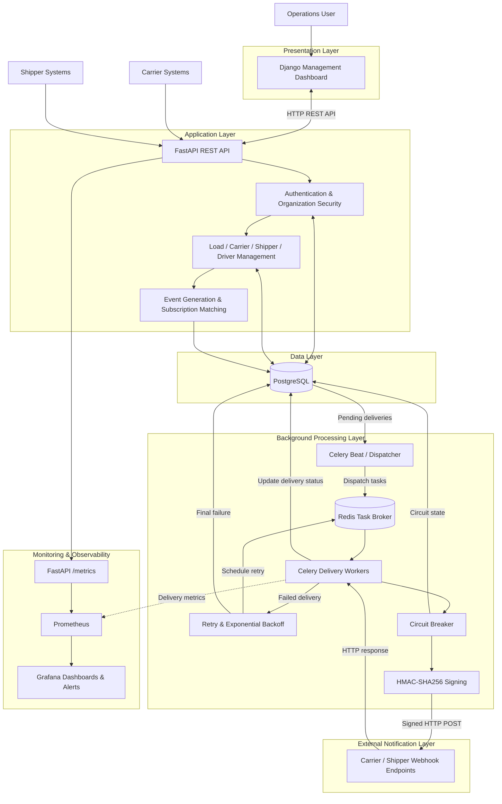

# Carrier-Shipper Webhook Notification System

A reliable event-driven notification platform for carrier and shipper operations. The system records business events, creates webhook deliveries, and processes notifications asynchronously with retries, HMAC-SHA256 signatures, and circuit-breaker protection.

## Features

- FastAPI REST API for webhook, event, delivery, authentication, and trucking operations.
- Carrier, shipper, driver, and load management.
- Event-driven webhook delivery.
- Celery background workers with Redis as the message broker.
- PostgreSQL persistence using SQLAlchemy and Alembic migrations.
- HMAC-SHA256 webhook request signatures.
- Configurable retry handling with exponential backoff and jitter.
- Circuit breaker with closed, open, and half-open states.
- Delivery attempt history and stale-processing recovery.
- JWT-based authentication and organisation-level access controls.
- Django management dashboard.
- Prometheus metrics and Grafana monitoring.


## System Architecture

The Carrier–Shipper Webhook Notification System uses an event-driven architecture to process load lifecycle events and reliably deliver webhook notifications to carrier and shipper endpoints.


## Technology Stack

| Component | Technology |
|---|---|
| Backend API | FastAPI |
| Frontend | Django |
| Database | PostgreSQL |
| ORM | SQLAlchemy |
| Migrations | Alembic |
| Background jobs | Celery |
| Message broker | Redis |
| Authentication | JWT |
| Monitoring | Prometheus and Grafana |
| Webhook security | HMAC-SHA256 |
| Testing | Pytest |
| Infrastructure | Docker Compose |

## Architecture

1. A carrier or shipper operation creates or updates a load.
2. The backend records the corresponding business event in PostgreSQL.
3. Matching active webhooks receive delivery records.
4. The dispatcher claims eligible deliveries and queues background tasks.
5. Celery workers send signed HTTP requests to subscriber endpoints.
6. Delivery results and attempt history are saved in PostgreSQL.
7. Retry handling and circuit-breaker logic manage temporary failures.
8. Prometheus collects application metrics for Grafana dashboards and alerts.

## Project Structure

```text
Carrier-Shipper-Webhook-Notification-System/
├── alembic/                  # Database migration scripts
├── app/
│   ├── api/                  # FastAPI routers
│   ├── observability/        # Logging and metrics
│   ├── security/             # Security utilities
│   ├── services/             # Business and delivery services
│   ├── workers/              # Celery tasks and dispatcher
│   ├── models.py             # SQLAlchemy models
│   ├── config.py             # Backend configuration
│   └── main.py               # FastAPI application
├── frontend/                 # Django management frontend
├── scripts/                  # Utility scripts
├── tests/                    # Automated tests
├── docker-compose.yml        # Infrastructure services
├── prometheus.yml            # Prometheus scrape configuration
├── requirements.txt          # Pinned Python dependencies
├── .env.example              # Environment variable template
└── README.md
```

## Prerequisites

- Python 3.13
- Docker Desktop with Docker Compose
- Git
- PowerShell (commands below use PowerShell syntax)

## Local Setup

### 1. Clone the repository

```powershell
git clone <repository-url>
cd Carrier-Shipper-Webhook-Notification-System
```

### 2. Create a virtual environment

```powershell
python -m venv .venv
.venv\Scripts\Activate.ps1
```

### 3. Install dependencies

```powershell
python -m pip install --upgrade pip
pip install -r requirements.txt
```

### 4. Configure environment variables

Create your local environment file:

```powershell
Copy-Item .env.example .env
```

Edit `.env` and replace all placeholder values.

Important configuration:

- `DATABASE_URL`: PostgreSQL connection string.
- `REDIS_URL`: Redis connection string.
- `SECRET_KEY`: Backend authentication secret.
- `WEBHOOK_ENCRYPTION_KEY`: Valid Fernet key for webhook secret encryption.
- `JWT_ALGORITHM`: JWT signing algorithm.
- `DJANGO_SECRET_KEY`: Separate Django frontend secret.
- `ALLOW_LOCAL_HTTP_WEBHOOKS`: Keep `false` except when deliberately testing local HTTP webhook receivers.
- `GRAFANA_SMTP_USER` and `GRAFANA_SMTP_PASSWORD`: Optional Grafana email configuration.

Use strong, unique secrets. Never commit `.env` or real credentials.

The Django settings read `DJANGO_SECRET_KEY` from the process environment. Set it in PowerShell before starting Django:

```powershell
$env:DJANGO_SECRET_KEY = "<your-django-secret>"
```

### 5. Start infrastructure services

```powershell
docker compose up -d postgres redis prometheus grafana
```

Check service status:

```powershell
docker compose ps
```

Default local service addresses:

| Service | Address |
|---|---|
| PostgreSQL | localhost:5433 |
| Redis | localhost:6379 |
| Prometheus | http://localhost:9090 |
| Grafana | http://localhost:3001 |

Docker Compose starts the infrastructure services. The FastAPI backend, Celery processes, and Django frontend are started separately during local development.

### 6. Apply database migrations

From the project root:

```powershell
alembic upgrade head
```

Check the current migration:

```powershell
alembic current
```

### 7. Start the FastAPI backend

From the project root:

```powershell
python -m uvicorn app.main:app --host 127.0.0.1 --port 8000 --reload
```

API documentation:

- Swagger UI: http://127.0.0.1:8000/docs
- ReDoc: http://127.0.0.1:8000/redoc
- Health: http://127.0.0.1:8000/health
- Database health: http://127.0.0.1:8000/health/database
- Metrics: http://127.0.0.1:8000/metrics

### 8. Start the Celery worker

Open another PowerShell terminal, activate the virtual environment, navigate to the project root, and run:

```powershell
celery -A app.workers.celery_app worker --loglevel=INFO --pool=solo
```

### 9. Start Celery Beat

Open another terminal and run:

```powershell
python -m celery -A app.workers.celery_app:celery_app beat --loglevel=info
```

### 10. Start the Django frontend

Open another terminal and run:

```powershell
cd frontend
python manage.py migrate
python manage.py runserver 127.0.0.1:8001
```

Open:

http://127.0.0.1:8001

The Django frontend uses its own local SQLite database. Its API connection is configured to use `http://127.0.0.1:8000`.

## Main API Areas

| Area | Purpose |
|---|---|
| Authentication | User authentication and access control |
| Webhooks | Subscriber endpoint configuration |
| Events | Business event creation and retrieval |
| Deliveries | Delivery status and attempt history |
| Carriers | Carrier organisation management |
| Shippers | Shipper organisation management |
| Drivers | Driver management |
| Loads | Load creation, assignment, and status updates |
| Health | Application and database health checks |
| Metrics | Prometheus metrics endpoint |

The complete interactive API reference is available at `/docs` while FastAPI is running.

## Webhook Delivery Reliability

The delivery engine includes:

- Unique event idempotency keys.
- Unique event-to-webhook delivery records.
- Claim tokens to prevent stale workers from completing a delivery.
- HTTP request timeouts and disabled redirect following.
- HMAC-SHA256 request signatures.
- Retryable and permanent failure classification.
- Exponential retry backoff with jitter.
- Circuit-breaker states and half-open probe handling.
- Recovery of deliveries left in processing after worker interruption.
- Persistent delivery attempt history.

Webhook requests include:

- `X-Webhook-Signature`
- `X-Webhook-Event`
- `X-Webhook-Delivery`
- `X-Webhook-Timestamp`

## Monitoring

Prometheus is configured to scrape the FastAPI metrics endpoint through:

```text
host.docker.internal:8000/metrics
```

Prometheus:

http://localhost:9090

Grafana:

http://localhost:3001

Grafana SMTP settings are supplied through environment variables. Configure your SMTP credentials before relying on email notifications.

## Testing

Run the complete test suite from the project root:

```powershell
python -m pytest -v
```

Run a focused test module:

```powershell
python -m pytest tests/test_worker.py -v
python -m pytest tests/test_dispatcher.py -v
```

Check dependency consistency:

```powershell
python -m pip check
```

## Security Notes

- Never commit `.env`, credentials, access tokens, or encryption keys.
- Use unique secrets for FastAPI and Django.
- Use HTTPS for externally accessible webhook endpoints.
- Keep local HTTP webhook support disabled except during controlled local testing.
- Restrict database, Redis, Prometheus, and Grafana access appropriately in deployed environments.
- Configure production security settings before deployment. The current Django configuration is intended for local development.

## Current Scope

This repository documents a local development setup. Docker Compose provides PostgreSQL, Redis, Prometheus, and Grafana; the Python application processes are launched separately. A production application image and deployment configuration are not included here.
